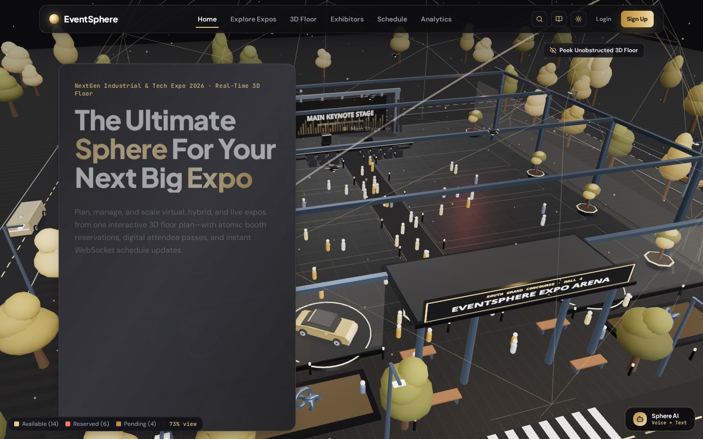
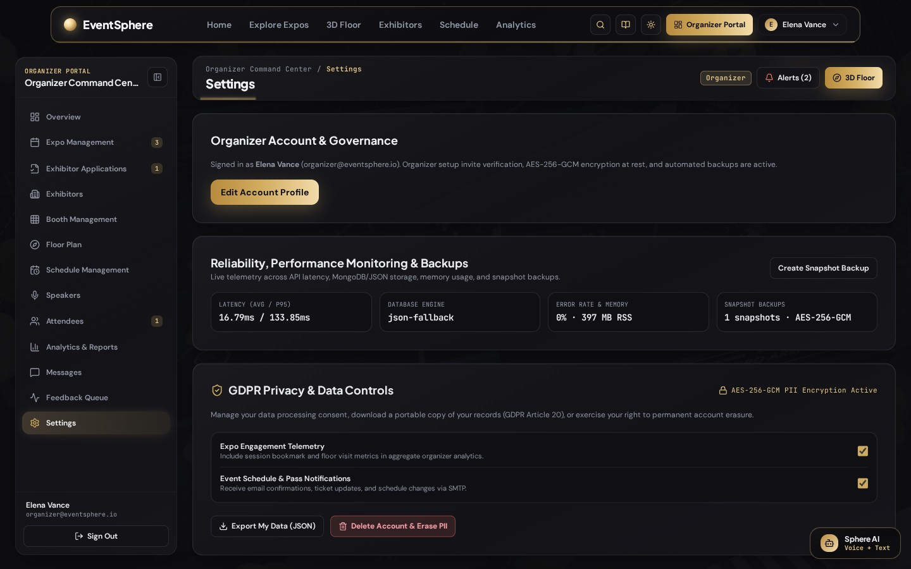
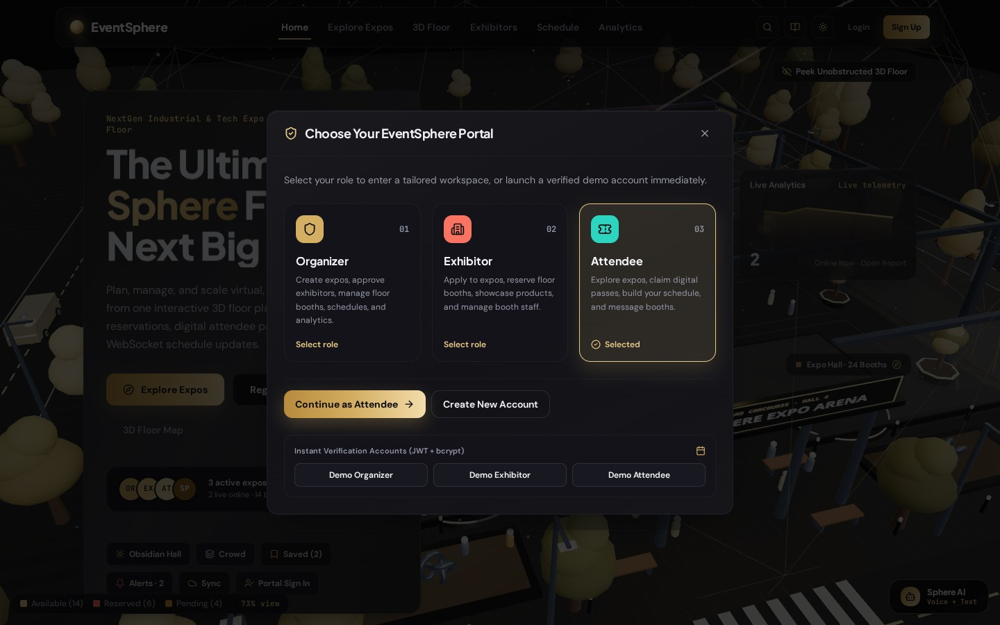
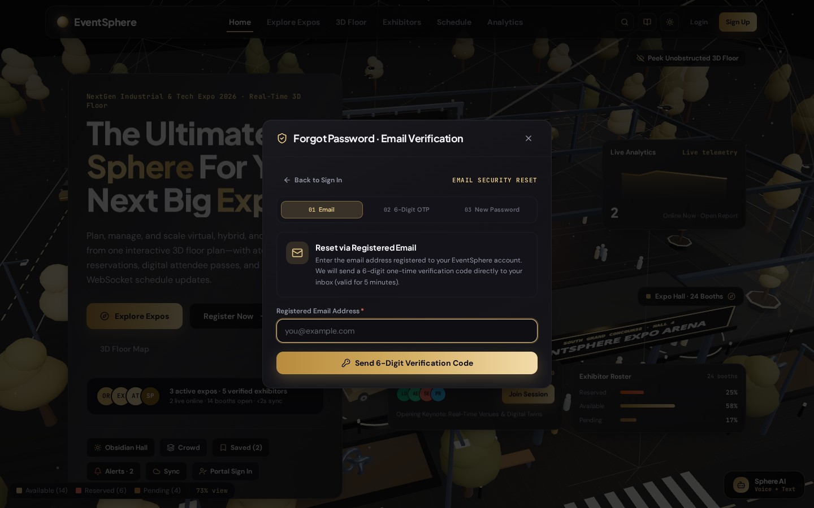
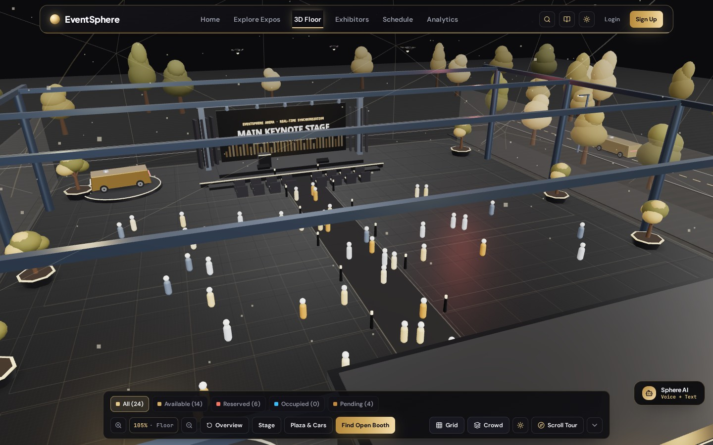
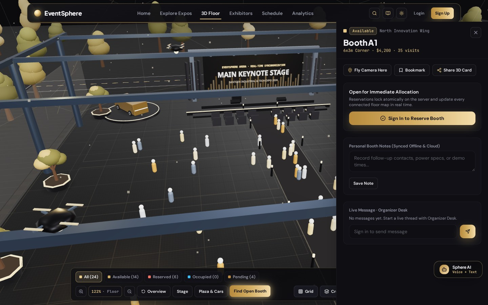
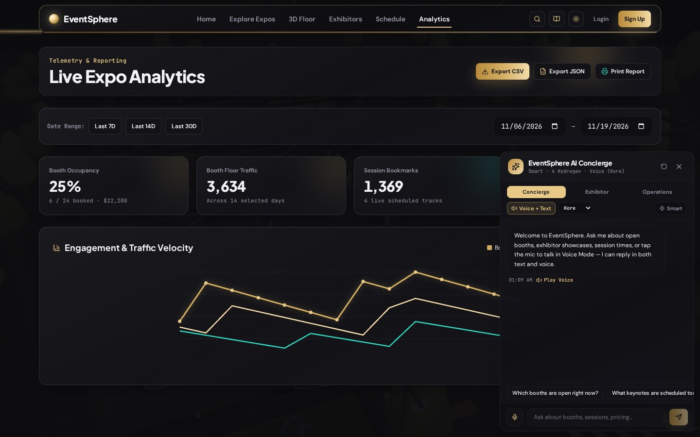
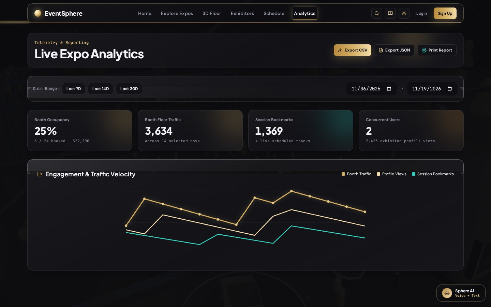

# EventSphere Management — Complete Developer Documentation

This guide covers the system architecture, codebase organization, environment configuration, database schemas, REST API reference, WebSocket event protocol, Three.js 3D engine, security implementation, testing, and deployment workflows for **EventSphere Management**.

---

## Table of Contents

1. [Architecture Overview](#1-architecture-overview)
2. [Repository Structure](#2-repository-structure)
3. [Local Setup & Environment Variables](#3-local-setup--environment-variables)
4. [Database & Persistence Layer](#4-database--persistence-layer)
5. [REST API Reference](#5-rest-api-reference)
6. [Socket.io Real-Time Event Protocol](#6-socketio-real-time-event-protocol)
7. [Security & Privacy Architecture](#7-security--privacy-architecture)
8. [3D WebGL Engine (Three.js)](#8-3d-webgl-engine-threejs)
9. [Frontend State, Offline PWA & API Client](#9-frontend-state-offline-pwa--api-client)
10. [AI Concierge Integration (`@google/genai`)](#10-ai-concierge-integration-googlegenai)
11. [Testing, Linting & Build Verification](#11-testing-linting--build-verification)
12. [Deployment & Operations](#12-deployment--operations)

---

## 1. Architecture Overview

EventSphere runs as a unified single-process Node.js application (`server.js`) on **port 3000** (`0.0.0.0`):

- **Development Mode (`NODE_ENV !== 'production'`)**: `server.js` mounts Vite (`createViteServer({ server: { middlewareMode: true }, appType: 'spa' })`) directly on Express so frontend HMR/assets and backend API/Socket.io routes share one origin.
- **Production Mode (`NODE_ENV === 'production'`)**: `server.js` serves the static Vite bundle from `dist/` with an SPA fallback to `dist/index.html`, alongside `/api/*`, `/health`, and Socket.io.
- **Tech Stack**:
  - **Frontend**: React 19 (JSX), Tailwind CSS v4 (`@tailwindcss/vite`), Motion (`motion/react`), GSAP + ScrollTrigger, Lucide React, Three.js (`three`), Axios, Socket.io Client, `vite-plugin-pwa` (Workbox).
  - **Backend**: Node.js 22+, Express 4, Socket.io 4, `jsonwebtoken`, `bcryptjs`, `nodemailer`, MongoDB Node Driver 7, `@google/genai`.


*Figure 1.1 — EventSphere unified client/server entry rendering React 19 UI overlays above the persistent Three.js WebGL canvas.*

---

## 2. Repository Structure

```text
/
├── server.js                      # Express + Socket.io + Vite middleware entry point & all REST routes
├── server/
│   ├── mailer.js                  # Nodemailer SMTP delivery (Brevo, Gmail, or custom SMTP) + HTML templates
│   ├── mongoStore.js              # MongoDB Atlas persistence, queued bulkWrite sync & syncVault store
│   ├── monitoring.js              # In-memory ServerMonitor (request count, avg/p95 latency, 5xx tracking)
│   └── security.js                # AES-256-GCM PII encryption, HMAC OTPs, rate limiters, HSTS/COOP headers
├── scripts/
│   └── setup-env.mjs              # CLI script (`npm run setup:env`) generating .env with random secrets
├── src/
│   ├── main.jsx                   # React root mount + PWA Service Worker registration
│   ├── App.jsx                    # Root state, Socket.io listeners, view router, modals & keyboard shortcuts
│   ├── index.css                  # Tailwind v4 theme variables (--es-bg, --es-accent, kinetic animations)
│   ├── data/
│   │   └── offlineFallbackSeed.js # Deterministic offline seed state when server & cache are unavailable
│   ├── hooks/
│   │   ├── useOnlineStatus.js     # Navigator online/offline reactive listener
│   │   └── usePWAInstall.js       # beforeinstallprompt capture & install trigger
│   ├── services/
│   │   ├── api.js                 # Modular domain Axios clients, Bearer interceptor & error normalizer
│   │   ├── eventSphereClient.js   # Unified frontend API facade + localStorage cache/workspace/sync helpers
│   │   └── gmailAuth.js           # Optional Firebase Google OAuth helper (env-configured)
│   ├── three/
│   │   ├── ExpoHallCanvas.jsx     # WebGL renderer, RoomEnvironment, EffectComposer, OrbitControls, raycasting
│   │   ├── expoModels.js          # 24-booth procedural geometry, status colors, stage, geodesic dome, crowd
│   │   └── expoScenery.js         # Surrounding campus roads, plaza cars, streetlights & trees
│   └── components/
│       ├── TopNav.jsx             # Sticky glass header with scroll progress bar, search, theme & user menu
│       ├── EventVoyageView.jsx    # Scroll Tour landing experience + GSAP ScrollTrigger choreography
│       ├── FloorExploreHud.jsx    # Bottom 3D floor HUD (status filters, zoom presets, layer toggles)
│       ├── BoothInspectorDrawer.jsx # Slide-over booth inspector (3D focus, reserve/release, notes, chat)
│       ├── ExpoAnalyticsDashboard.jsx # KPI cards, date-range filter, SVG charts, CSV/JSON/Print export
│       ├── FavoritesView.jsx      # Saved booths, field notes & bookmarked sessions manager
│       ├── EventSphereAssistant.jsx # Gemini AI Concierge drawer (Text + Mic Transcription + TTS)
│       ├── AuthModal.jsx          # Role selector, Login, Sign Up, Profile & 3-Step Email OTP Reset
│       ├── CloudBackupModal.jsx   # Sync Key cloud vault push/pull + JSON export/import
│       ├── SearchModal.jsx        # Global `/` search across booths, exhibitors, expos & sessions
│       ├── ShareModal.jsx         # 3D canvas PNG snapshot & deep-link share dialog
│       ├── NotificationAndFeedbackModal.jsx # Real-time alerts & feedback submission modal
│       ├── PrivacyAndComplianceCard.jsx # GDPR consent toggles, Article 20 export & account deletion
│       ├── VenueWeatherWidget.jsx # Open-Meteo venue telemetry widget (°C/°F)
│       ├── PWAStatusWidgets.jsx   # Install prompt button & offline banner
│       ├── PublicFooter.jsx       # Footer navigation & compliance links
│       ├── portals/
│       │   ├── DashboardLayout.jsx # Shared responsive portal shell (sidebar + topbar)
│       │   ├── AttendeePortal.jsx  # Attendee Hub (11 sections incl. QR pass generator)
│       │   ├── ExhibitorPortal.jsx # Exhibitor Portal (applications, booth booking, catalog, staff)
│       │   └── OrganizerPortal.jsx # Admin Command Center (CRUD, approvals, monitoring, backups)
│       └── ui/                    # Reusable primitives (Button, Card, Modal, DataTable, FormControls)
├── tests/
│   ├── eventsphere.test.mjs       # End-to-end HTTP + Socket.io integration tests (RBAC, atomic booking, OTP)
│   ├── frontend-services.test.mjs # Unit tests for Axios error normalization & client helpers
│   ├── security-unit.test.mjs     # Unit tests for AES-256-GCM, password policy, HMAC OTP & rate limiter
│   └── startup-config.test.mjs    # Subprocess boot tests for secret/config validation
├── docs/                          # User & Developer documentation
├── public/                        # PWA icons, manifest assets, and media assets
├── vite.config.js                 # Vite + React + Tailwind + VitePWA Workbox configuration
└── package.json                   # Scripts & dependencies
```

---

## 3. Local Setup & Environment Variables

### Installation & Running
```bash
npm install
npm run setup:env    # Optional: generates .env with fresh random secrets
npm run dev          # Starts Express + Socket.io + Vite middleware on http://0.0.0.0:3000
```

### Environment Variables (`.env.example`)
| Variable | Required? | Description |
|---|---|---|
| `PORT` | No (default `3000`) | HTTP + WebSocket listen port |
| `JWT_SECRET` | Recommended (`>= 32` chars) | Signing secret for 7-day JWTs. Auto-generated into `.data/.runtime-secrets.json` if omitted. |
| `DATA_ENCRYPTION_KEY` | Recommended (`>= 32` chars) | `scrypt` input key for AES-256-GCM PII encryption & HMAC OTPs. |
| `ORGANIZER_SETUP_CODE` | Recommended (`>= 12` chars) | Invite code required to register an `admin` (Organizer) account. |
| `MONGODB_URI` | Optional | MongoDB Atlas / local connection string. Falls back to `.data/eventsphere-db.json` when unset. |
| `EVENTSPHERE_DISABLE_MONGO` | Optional (`true`) | Forces local JSON-file storage even if `MONGODB_URI` is set. |
| `EVENTSPHERE_DATA_DIR` | Optional (default `.data`) | Override directory for JSON database, vault, runtime secrets, and backups. |
| `EVENTSPHERE_DISABLE_RATE_LIMIT` | Optional (`true`) | Disables API/auth rate limiters (useful during automated test runs). |
| `GEMINI_API_KEY` | Optional | Server-side API key for `/api/assistant/*` (`@google/genai`). |
| `CLIENT_ORIGIN` | Optional | Comma-separated additional CORS origins for Socket.io. |
| `FORCE_HTTPS` | Optional (`true`) | Issues 308 redirect from HTTP to HTTPS behind TLS proxies. |
| `SMTP_HOST`, `SMTP_PORT`, `SMTP_USER`, `SMTP_PASSWORD`, `SMTP_FROM_EMAIL` | Optional | Generic SMTP relay for OTP & ticket confirmation emails. |
| `GMAIL_USER`, `GMAIL_APP_PASSWORD` | Optional | Gmail App Password shortcut for `nodemailer`. |
| `BREVO_API_KEY`, `BREVO_USER`, `BREVO_FROM_EMAIL` | Optional | Brevo SMTP relay shortcut. |
| `VITE_API_BASE_URL` | Optional | Explicit backend origin if frontend is deployed separately. |
| `VITE_FIREBASE_API_KEY`, `VITE_FIREBASE_AUTH_DOMAIN`, `VITE_FIREBASE_PROJECT_ID` | Optional | Client-side Firebase config for optional Gmail OAuth (`src/services/gmailAuth.js`). |

---

## 4. Database & Persistence Layer

Persistence is managed by `server/mongoStore.js` and `server.js`:
1. On startup, `connectMongoStore()` attempts to connect to `MONGODB_URI` (6s timeout). If unavailable, it seamlessly activates `json-fallback` mode using `.data/eventsphere-db.json`.
2. `saveDatabase(db)` performs atomic local writes (`.tmp` + `fs.renameSync`), maintains up to **7 rotating daily backups** in `.data/backups/eventsphere-YYYY-MM-DD.json`, and calls `queueSyncDatabaseToMongo(db)` to mirror collections asynchronously using serialized `bulkWrite` operations.
3. `migrateDatabase(db)` ensures backward compatibility on schema additions and encrypts plaintext phone fields at rest.

### MongoDB Collections & In-Memory State Keys
| Collection (`mongoStore.js`) | Primary Key (`_id`) | Contents |
|---|---|---|
| `es_users` | `user.id` | User credentials (`passwordHash`), `role` (`admin` \| `exhibitor` \| `attendee`), encrypted `phone`, GDPR consent flags. |
| `es_reset_tokens` | `token.email` | Active 6-digit HMAC OTP hashes (`expiresAt` 5m, `resendAvailableAt` 60s, `maxAttempts` 5) and verified reset session hashes. |
| `es_expos` | `expo.id` | Expo metadata (`title`, `date`, `endDate`, `location`, `theme`, `category`, `status`, `capacity`, `registeredUserIds`). |
| `es_booths` | `booth.id` | 24+ booths (`number`, `zone`, `size`, `priceUsd`, `status`, `row`, `col`, `exhibitorId`, `exhibitorName`, `trafficCount`). |
| `es_exhibitors` | `exhibitor.id` | Company profile (`companyName`, `category`, `tagline`, `logoColor`, `products[]`, `staff[]`, `documents[]`, encrypted `phone`, `profileViews`). |
| `es_applications` | `app.id` | Exhibitor applications (`status`: `pending` \| `approved` \| `rejected` \| `info_requested`, `reviewerNote`, `rejectionReason`). |
| `es_registrations` | `reg.id` | Attendee expo tickets (`ticketCode` e.g. `ES-2026-8412`, `status`: `confirmed` \| `cancelled`). |
| `es_sessions` | `session.id` | Schedule items (`startTime`, `endTime`, `location`, `speaker`, `capacity`, `registeredUserIds[]`, `bookmarkedUserIds[]`). |
| `es_speakers` | `speaker.id` | Speaker biographies & topics. |
| `es_messages` | `msg.id` | Capped to latest 150 chat messages (`recipientChannel`: `'organizer'` \| `'hall-general'` \| `exhibitorId`). |
| `es_notifications` | `noti.id` | Capped to latest 60 alerts (`targetUserId`: `'all'` or specific `userId`, `readBy[]`). |
| `es_feedback` | `fb.id` | Support & feedback entries (`status`: `'open'` \| `'resolved'`). |
| `es_activity_logs` | `log.id` | Capped to latest 100 audit trail entries (Admin-only visibility). |
| `es_analytics_series` | `point.date` | 30-day rolling daily metrics (`boothTraffic`, `sessionBookmarks`, `profileViews`). |
| `es_sync_vault` | `record.syncKey` | Cross-device workspace backups (`payload`, `deviceLabel`, `checksum`, `updatedAt`). |

---

## 5. REST API Reference

All `/api/*` endpoints support gzip compression for JSON payloads `>= 1 KB`, are tracked by `ServerMonitor`, and are protected by sliding-window rate limiting (`400 req/min` general, `60 req/min` auth).

### Health, Metrics, State & Weather
| Method & Path | Auth | Description |
|---|---|---|
| `GET /health` | Public | Root uptime probe returning `{ status, service, version, uptime, database, dbConnected, smtp, timestamp }`. |
| `GET /api/health` | Public | Detailed JSON service status (`encryptionAtRest: "aes-256-gcm"`). |
| `GET /api/metrics` | Public | Server latency (`avgMs`, `p95Ms`), request counters, error count, and backup count. |
| `GET /api/state` | Optional JWT | Returns role-scoped state snapshot (`getPublicSnapshot(viewer)`). Admin receives full logs/applications/messages; guests receive public slices. |
| `GET /api/weather?location=...&refresh=1` | Public | Geocodes expo venue via Open-Meteo (with known venue coordinate fallback) and returns cached (5 min TTL) or live weather telemetry. |

### Authentication & GDPR (`/api/auth/*`)
| Method & Path | Auth | Request Body / Notes |
|---|---|---|
| `POST /api/auth/register` | Public | `{ name, email, password, role, gdprConsent, organizerInviteCode?, company?, phone?, category?, ... }` → `201 { token, user }`. |
| `POST /api/auth/login` | Public | `{ email, password }` → `200 { token, user }` or generic `401` (prevents user enumeration). |
| `POST /api/auth/forgot-password` | Public (`12/15m`) | `{ email }` → generates 6-digit OTP (5m TTL, 60s resend cooldown) & sends via SMTP if configured. |
| `POST /api/auth/verify-reset-otp` | Public (`25/15m`) | `{ email, otp }` → timing-safe HMAC check (max 5 attempts) → `{ ok, resetSessionToken }`. |
| `POST /api/auth/reset-password` | Public | `{ email, resetSessionToken, newPassword, confirmPassword }` → validates password policy & updates bcrypt hash. |
| `GET /api/auth/me` | Bearer JWT | Returns sanitized current user profile. |
| `PUT /api/auth/profile` | Bearer JWT | `{ name, company, title, phone }` → updates user & re-signs JWT. |
| `PUT /api/auth/privacy/consent` | Bearer JWT | `{ gdprConsent, analyticsTelemetry, marketingEmails }`. |
| `GET /api/auth/privacy/export` | Bearer JWT | Returns GDPR Article 20 portable JSON archive of all user records. |
| `DELETE /api/auth/account` | Bearer JWT | Erases PII, deletes user/reset tokens, and anonymizes historical messages/registrations. |

### Expos, Booths, Exhibitors & Applications
| Method & Path | Auth / Role | Description |
|---|---|---|
| `POST /api/expos` | `admin` | Creates a new expo (`title`, `date`, `location`, etc.). |
| `PUT /api/expos/:id` | `admin` | Updates expo details and broadcasts notification. |
| `DELETE /api/expos/:id` | `admin` | Deletes an expo. |
| `POST /api/expos/:id/register` | Authenticated | Registers attendee, generates unique `ES-YYYY-XXXX` ticket code, sends confirmation email. |
| `DELETE /api/expos/:id/register` | Authenticated | Cancels attendee expo registration. |
| `POST /api/booths` | `admin` | Creates a new booth (`number`, `zone`, `size`, `priceUsd`). |
| `PUT /api/booths/:id` | `admin` | Updates booth properties or assigns/unassigns an `exhibitorId`. |
| `DELETE /api/booths/:id` | `admin` | Deletes an unreserved/unoccupied booth (`409` if occupied/reserved). |
| `POST /api/booths/:id/reserve` | Authenticated | Atomically locks an `available` booth (`409` if already taken; `403` if exhibitor application is unapproved). |
| `POST /api/booths/:id/release` | Owner or `admin` | Releases booth back to `available`. |
| `POST /api/applications` | `exhibitor` \| `admin` | Submits exhibitor application & compliance docs. |
| `PUT /api/applications/:id` | `admin` | Reviews application (`approved` \| `rejected` \| `info_requested`), notifies & emails applicant. |
| `POST /api/applications/:id/request-info` | `admin` | Sets status to `info_requested` with `reviewerNote`. |
| `PUT /api/exhibitors/:id` | Owner or `admin` | Updates exhibitor showcase profile, products, staff, docs, and `logoColor`. |
| `POST /api/exhibitors/:id/view` | Public | Increments `profileViews` and updates daily analytics series. |

### Sessions, Speakers, Communications, Sync & Admin
| Method & Path | Auth / Role | Description |
|---|---|---|
| `POST /api/sessions` | `admin` | Publishes new session & emits `schedule:updated`. |
| `PUT /api/sessions/:id` | `admin` | Updates session time/location & broadcasts live alert. |
| `DELETE /api/sessions/:id` | `admin` | Removes session. |
| `POST /api/sessions/:id/register` | Authenticated | Toggles attendee seat registration for a session. |
| `POST /api/sessions/:id/bookmark` | Authenticated | Toggles session bookmark & schedules 15-minute reminder notification. |
| `POST/PUT/DELETE /api/speakers(/:id)` | `admin` | Speaker directory CRUD. |
| `POST /api/messages` | Authenticated | Posts message to `recipientChannel` & emits `chat:message`. |
| `POST /api/feedback` | Optional JWT | Submits feedback/support ticket. |
| `PUT /api/feedback/:id` | `admin` | Marks feedback ticket `open` or `resolved`. |
| `POST /api/notifications/read` | Authenticated | Marks all notifications read for current user. |
| `GET /api/admin/attendees` | `admin` | Returns attendee directory with decrypted contact info & counts. |
| `GET /api/admin/monitoring` | `admin` | Returns detailed server metrics, DB/SMTP status, and backup filenames. |
| `POST /api/admin/backup` | `admin` | Writes an on-demand snapshot file and triggers MongoDB sync. |
| `GET / PUT /api/sync/:syncKey` | Public (`[A-Z0-9-]{6,32}`) | Reads or writes cross-device workspace backup with SHA-256 checksum. |


*Figure 5.1 — Organizer Settings view consuming `GET /api/admin/monitoring`, `POST /api/admin/backup`, and `/api/auth/privacy/*` endpoints.*

---

## 6. Socket.io Real-Time Event Protocol

Socket.io shares the HTTP server on port 3000 with CORS restricted to `ALLOWED_ORIGINS` (same-origin + `CLIENT_ORIGIN` + localhost in dev).

| Event | Direction | Payload | Frontend Handling (`App.jsx`) |
|---|---|---|---|
| `presence:count` | Server → All | `number` (active connections) | Updates live concurrent user badge. |
| `state:sync` | Server → All | Public snapshot object | Guests apply directly; authenticated users merge public slices and re-fetch `GET /api/state` with their JWT to hydrate private records. |
| `booth:updated` | Server → All | Updated `booth` object | Patches matching booth in state + localStorage cache immediately. |
| `schedule:updated` | Server → All | Updated `session` object | Triggers state sync & schedule refresh. |
| `application:updated` | Server → All | Updated `application` object | Notifies exhibitor/admin state listeners. |
| `notification:new` | Server → All | `notification` object | Prepends alert & displays live toast banner. |
| `chat:message` | Server → All | `message` object | Appends deduplicated message to live chat thread. |

---

## 7. Security & Privacy Architecture

Implemented in `server/security.js` and verified in `SECURITY_AUDIT.md`:
- **Password Hashing**: `bcryptjs` (cost factor `10`). Policy requires `>= 8` chars with upper, lower, digit, and special character.
- **PII Encryption at Rest**: `encryptPii()` / `decryptPii()` use `aes-256-gcm` with random 12-byte IVs and 16-byte auth tags (`enc:v1:<iv>:<tag>:<ciphertext>`). Key derived via `crypto.scryptSync(RAW_SECRET, 'eventsphere-pii-v1-salt', 32)`.
- **OTP & Reset Session Security**: 6-digit CSPRNG OTP (`crypto.randomInt`) hashed via HMAC-SHA256, verified with `crypto.timingSafeEqual`, max 5 attempts, 5-minute TTL, 60-second resend cooldown, single-use invalidation.
- **Rate Limiting**: In-memory sliding-window buckets keyed by `${keyPrefix}:${clientIp}` returning `429` + `Retry-After` header.
- **HTTP Hardening**: `x-powered-by` disabled, `trust proxy` set to `1`, `X-Content-Type-Options: nosniff`, `Referrer-Policy: strict-origin-when-cross-origin`, `Cross-Origin-Opener-Policy: same-origin-allow-popups`, `Permissions-Policy: camera=(), microphone=(self), geolocation=()`, plus conditional `Strict-Transport-Security`.


*Figure 7.1 — Multi-role JWT authentication surface supporting Organizer (`admin`), Exhibitor, and Attendee RBAC tokens.*


*Figure 7.2 — CSPRNG 6-digit OTP reset flow protected by HMAC-SHA256 hashing, timing-safe checks, and sliding rate limits.*

---

## 8. 3D WebGL Engine (Three.js)

Located in `src/three/`:
- **`ExpoHallCanvas.jsx`**:
  - Initializes `THREE.WebGLRenderer` (ACESFilmicToneMapping) and `RoomEnvironment` PMREM lighting.
  - Detects software renderers (`SwiftShader` / `llvmpipe` / `software`) via `WEBGL_debug_renderer_info` and automatically scales down pixel ratio & disables `UnrealBloomPass` to maintain smooth frame rates.
  - Exposes imperative methods via `React.forwardRef`: `zoomIn()`, `zoomOut()`, `resetView()`, `focusStage()`, `focusPlaza()`, `focusBooth(boothId)`, and `captureSnapshot()` (returns PNG data URL for `ShareModal`).
  - Supports dual camera modes: `voyage` (scroll-driven orbital tour synchronized to `scrollProgress`) and `explore` (interactive `OrbitControls` with raycast hover tooltips and click-to-select booth focus).
- **`expoModels.js` & `expoScenery.js`**:
  - Procedurally builds the 4-zone, 24-booth arena floor, status-colored emissive booth frames (`STATUS_HEX`), geodesic wireframe sphere dome, Main Keynote Stage, overhead truss lighting, animated floor visitors, entrance plaza, trees, and moving vehicles.


*Figure 8.1 — `ExpoHallCanvas.jsx` running OrbitControls, geodesic wireframe dome, keynote stage, and status-tinted booths.*


*Figure 8.2 — Raycasted booth selection triggering imperative `focusBooth(id)` camera animation and `BoothInspectorDrawer` telemetry.*

---

## 9. Frontend State, Offline PWA & API Client

- **`src/services/api.js`**: Creates domain-scoped Axios instances (`authApiClient`, `expoApiClient`, `boothApiClient`, `adminApiClient`, `assistantApiClient`, `syncApiClient`, etc.) with automatic `Authorization: Bearer <token>` injection from `localStorage` (`eventsphere_auth_token_v1`) and normalized error objects (`{ ok: false, error, status, code, isNetworkError }`).
- **`src/services/eventSphereClient.js`**: Wraps `api.js` and manages local persistence keys (`eventsphere_snapshot_v1`, `eventsphere_workspace_v1`, `eventsphere_sync_meta_v1`, `eventsphere_auth_user_v1`) seeded from `src/data/offlineFallbackSeed.js`.
- **`vite.config.js` (`VitePWA`)**: Pre-caches `js, css, html, ico, png, svg, woff, woff2` (up to 5 MB/file) and caches Google Fonts with `CacheFirst`. `src/main.jsx` registers the SW via `registerSW({ immediate: true })`.

---

## 10. AI Concierge Integration (`@google/genai`)

All Gemini calls are strictly server-side in `server.js` using `GEMINI_API_KEY`:
- **`POST /api/assistant/chat`**: Builds a live system prompt containing real-time expo, booth, exhibitor, and session summaries. Uses `gemini-4-hydrogen` (default) or `gemini-3.1-flash-lite` (`fastMode: true`), and extracts mentioned booth IDs (`mentionedBoothIds`) for clickable 3D navigation.
- **`POST /api/assistant/transcribe`**: Accepts `audioBase64` (`audio/webm` etc.) and transcribes speech via `gemini-3.5-transcribe`.
- **`POST /api/assistant/tts`**: Synthesizes spoken audio via `gemini-3.8-flash-lite-tts` (`responseModalities: ['AUDIO']`) supporting voices `Kore`, `Puck`, `Charon`, `Fenrir`, and `Zephyr`.


*Figure 10.1 — `EventSphereAssistant.jsx` connected to `/api/assistant/chat`, `/api/assistant/transcribe`, and `/api/assistant/tts`.*


*Figure 10.2 — `ExpoAnalyticsDashboard.jsx` rendering `analyticsSeries` KPIs with CSV/JSON export and date-range aggregation.*

---

## 11. Testing, Linting & Build Verification

### Available NPM Scripts
```bash
npm run lint        # Validates all 49+ JS/JSX/MJS files via esbuild transform
npm run build       # Produces optimized production bundle in dist/ + PWA Service Worker
npm test            # Executes all integration, unit, and startup tests via node --test
npm run setup:env   # Generates .env with fresh random secrets
npm run dev         # Starts development server (Express + Socket.io + Vite middleware)
npm start           # Starts production server (serves dist/ + API + Socket.io)
```

### Test Suites (`tests/*.test.mjs`)
- `tests/eventsphere.test.mjs`: Boots an isolated test server on an ephemeral port and exercises auth, RBAC, expo/booth/session CRUD, atomic 409 booth reservation conflicts, OTP password reset, GDPR export/erasure, Socket.io broadcasts, and metrics.
- `tests/security-unit.test.mjs`: Verifies AES-256-GCM roundtrips, tampered ciphertext rejection, password policy rules, OTP timing-safe verification, and sliding-window rate limiters.
- `tests/frontend-services.test.mjs`: Validates Axios error normalization and client helpers.
- `tests/startup-config.test.mjs`: Verifies startup secret validation rules.

---

## 12. Deployment & Operations

1. **Build Frontend**: Run `npm run build` to compile `dist/`.
2. **Configure Production Environment**:
   - Set `NODE_ENV=production` and `PORT=3000`.
   - Provide strong random values for `JWT_SECRET`, `DATA_ENCRYPTION_KEY`, and `ORGANIZER_SETUP_CODE`.
   - Set `MONGODB_URI` to your MongoDB Atlas cluster (or `EVENTSPHERE_DISABLE_MONGO=true` to use local JSON persistence).
   - Set `GEMINI_API_KEY` for the AI Concierge and SMTP credentials for OTP/ticket emails.
   - Set `FORCE_HTTPS=true` if behind a TLS-terminating reverse proxy.
3. **Start Process**: Run `npm start` (`node server.js`).
4. **Health Monitoring**: Point uptime monitors (UptimeRobot, BetterStack, Cloud Run health checks) to `GET /health`.
