# EventSphere Management — Complete User Documentation

Welcome to **EventSphere Management**, an enterprise 3D exhibition and trade-show platform that unites **Organizers**, **Exhibitors**, and **Attendees** on a single real-time synchronized floor plan.

---

## Table of Contents

1. [Platform Overview & User Roles](#1-platform-overview--user-roles)
2. [Quick Start & Demo Accounts](#2-quick-start--demo-accounts)
3. [Account Registration, Login & Password Reset](#3-account-registration-login--password-reset)
4. [Navigating EventSphere](#4-navigating-eventsphere)
5. [Interactive 3D Expo Hall Tutorial](#5-interactive-3d-expo-hall-tutorial)
6. [Booth Inspector Drawer Tutorial](#6-booth-inspector-drawer-tutorial)
7. [Attendee Guide & Tutorial](#7-attendee-guide--tutorial)
8. [Exhibitor Guide & Tutorial](#8-exhibitor-guide--tutorial)
9. [Organizer (Admin) Guide & Tutorial](#9-organizer-admin-guide--tutorial)
10. [EventSphere AI Concierge (Text & Voice)](#10-eventsphere-ai-concierge-text--voice)
11. [Venue Weather Telemetry](#11-venue-weather-telemetry)
12. [Offline PWA & Cross-Device Cloud Sync Vault](#12-offline-pwa--cross-device-cloud-sync-vault)
13. [GDPR Privacy & Compliance Controls](#13-gdpr-privacy--compliance-controls)
14. [Frequently Asked Questions (FAQs)](#14-frequently-asked-questions-faqs)

---

## 1. Platform Overview & User Roles

EventSphere runs on a live WebSocket-synchronized floor plan (`< 2s` propagation across connected browsers) rendered in interactive 3D WebGL.

| Role | Primary Capabilities | Portal Name |
|---|---|---|
| **Guest Visitor** | Browse the 3D Expo Arena, inspect booths, search expos/sessions, view analytics, and ask the AI Concierge. | Public Scroll Tour & 3D Floor |
| **Attendee** | Register for expos, receive digital QR passes, bookmark sessions with reminders, save favorite booths & private notes, chat with exhibitors, and submit feedback. | **Attendee Hub** |
| **Exhibitor** | Customize company showcase profile, list products & staff, submit expo applications, atomically reserve or release floor booths, and chat with organizers & attendees. | **Exhibitor Portal** |
| **Organizer (Admin)** | Create/edit expos, approve/reject/request info on exhibitor applications, allocate booths, publish live schedule updates, manage speakers, export analytics, and monitor server health & backups. | **Organizer Command Center** |

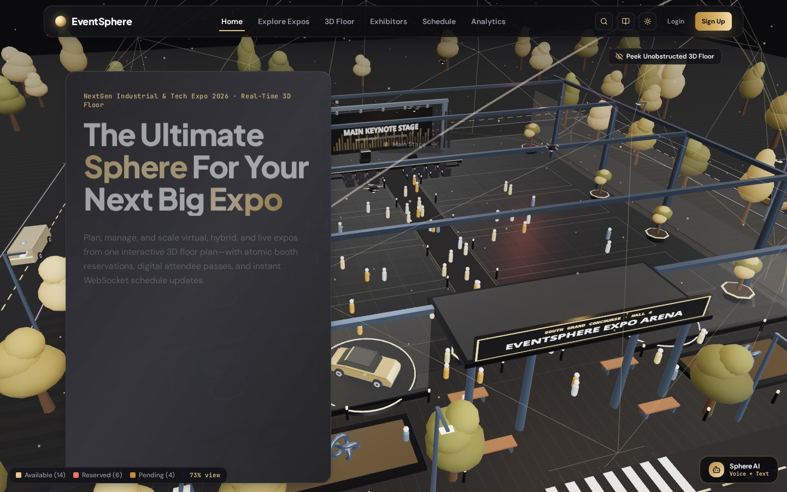
*Figure 1.1 — Public Scroll Tour landing view rendered over the live Three.js WebGL 3D Expo Arena in Obsidian Dark Mode.*

---

## 2. Quick Start & Demo Accounts

You can explore EventSphere immediately using the built-in one-click demo accounts inside the **Login / Sign Up** modal (`Role Selector` → **Instant Verification Accounts**):

| Role | Email | Password |
|---|---|---|
| **Organizer (Admin)** | `organizer@eventsphere.io` | `ExpoAdmin2026!` |
| **Exhibitor Partner** | `exhibitor@lumina-robotics.io` | `Exhibitor2026!` |
| **Exhibitor Partner 2** | `exhibitor@aethergrid.io` | `Exhibitor2026!` |
| **Attendee Visitor** | `attendee@eventsphere.io` | `Attendee2026!` |

> **Tip:** Click **Login** in the top navigation bar, select a role card, or click one of the three **Demo Organizer / Demo Exhibitor / Demo Attendee** buttons at the bottom of the role selector to sign in instantly.

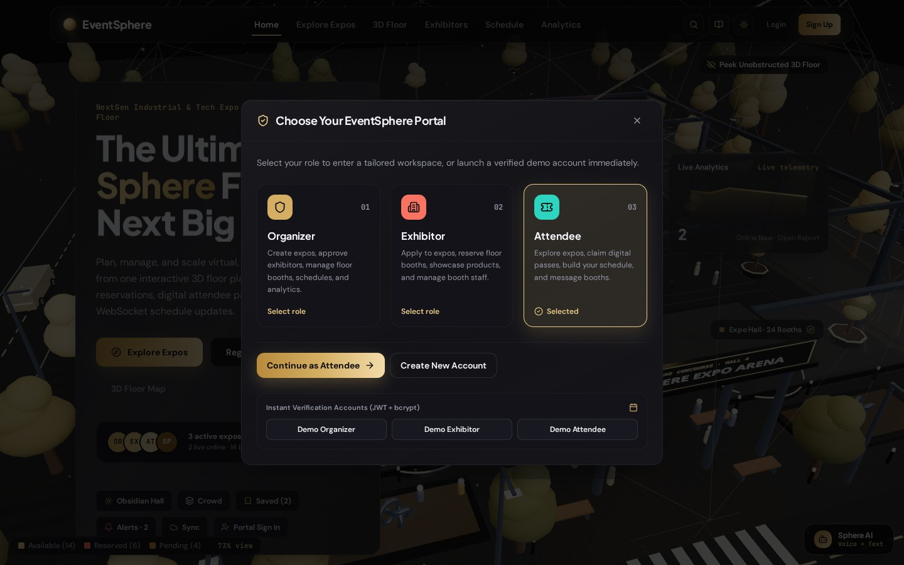
*Figure 2.1 — Choose Your EventSphere Portal role selector modal with one-click Instant Verification demo accounts.*

---

## 3. Account Registration, Login & Password Reset

### Creating a New Account
1. Click **Sign Up** in the top-right navigation bar.
2. Choose your portal role: **Attendee**, **Exhibitor**, or **Organizer**.
3. Fill in your **Full Name**, **Work Email**, **Phone Number** (encrypted at rest), and **Company**.
   - **Exhibitors** can also enter their Industry Sector, Website, Overview, Featured Products (comma-separated), Brand Accent Color swatch, and Compliance Documents right during sign-up.
   - **Organizers** must enter a valid server-verified **Organizer Provisioning Invite Code** (`ORGANIZER_SETUP_CODE` configured on the server).
4. Create a strong password meeting all 5 security rules:
   - Minimum **8 characters**
   - At least **1 uppercase letter** (`A–Z`)
   - At least **1 lowercase letter** (`a–z`)
   - At least **1 number** (`0–9`)
   - At least **1 special character** (e.g., `!@#$%`)
5. Check the **GDPR data-processing consent** box and click **Create Account**.

### 3-Step Email OTP Password Reset Tutorial
1. Open the **Sign In** dialog and click **Forgot password?** (or visit `/forgot-password`).
2. **Step 01 — Email:** Enter your registered email address and click **Send 6-Digit Verification Code**. A 6-digit OTP valid for **5 minutes** is sent to your inbox (with a 60-second resend cooldown).
3. **Step 02 — 6-Digit OTP:** Enter or paste the 6-digit code into the digit boxes (supports auto-advance and keyboard navigation). Click **Verify Code & Continue**.
4. **Step 03 — New Password:** Enter and confirm your new password while watching the live **5-point Password Strength Meter** turn gold (`Strong 5/5`), then submit to complete the reset.

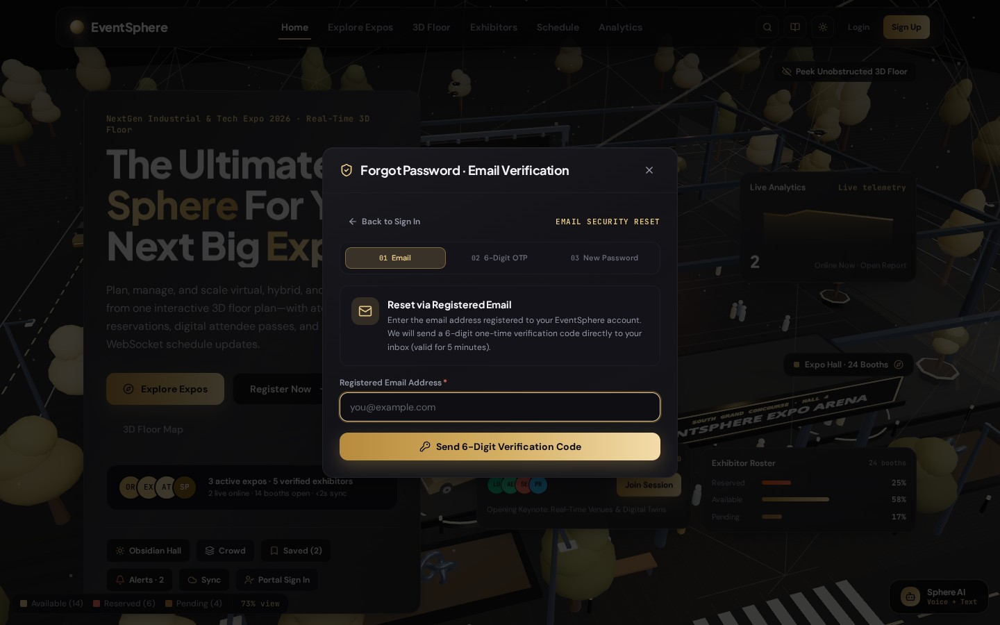
*Figure 3.1 — Dedicated 3-step Email Security Reset flow (01 Email → 02 6-Digit OTP → 03 New Password).*

---

## 4. Navigating EventSphere

### Top Navigation Bar (`TopNav`)
- **Home**: Returns to the Scroll Tour hero landing view over the 3D Expo Sphere.
- **Explore Expos**: Smooth-scrolls to the live & upcoming exhibitions directory.
- **3D Floor**: Switches to full-screen interactive 3D Exploration mode with OrbitControls and the bottom HUD.
- **Exhibitors**: Scrolls to the verified exhibitors & 24-booth matrix section.
- **Schedule**: Scrolls to the Keynote & Technical Sessions timetable.
- **Analytics**: Opens the real-time Expo Analytics & Engagement Dashboard.
- **Global Search (`/`)**: Opens instant search across booths, exhibitors, expos, and sessions. Press `/` anywhere to open; press `Escape` to close.
- **Theme Toggle (Sun / Moon)**: Switches between **Obsidian Dark Mode** and **Alabaster Light Mode** (also updates 3D hall lighting).
- **User Menu** (when signed in): Quick access to **My Portal Dashboard**, **Saved Bookmarks**, **Cloud Sync Vault**, **Account Profile**, and **Sign Out**.

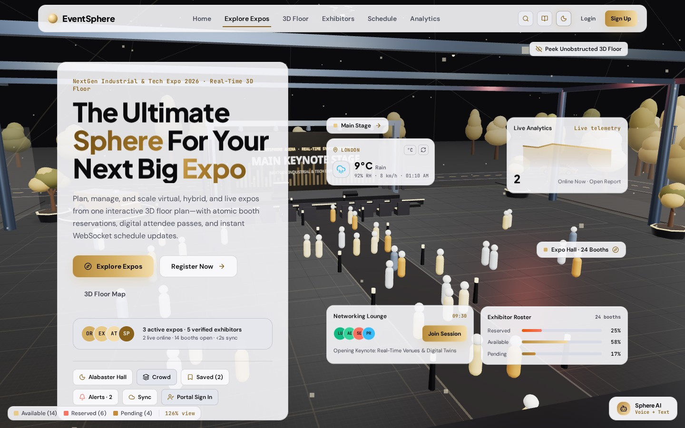
*Figure 4.1 — EventSphere switched to Alabaster Light Mode with synchronized sticky navigation and telemetry widgets.*

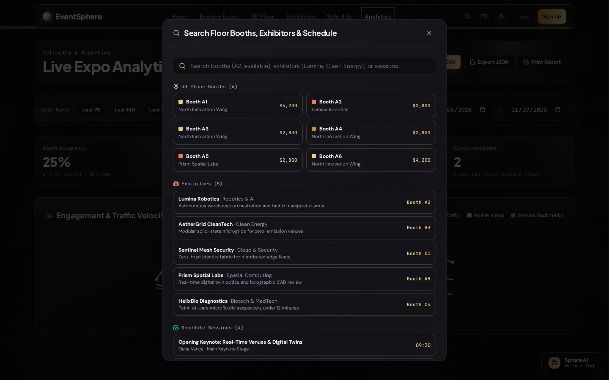
*Figure 4.2 — Global Search modal (`/` shortcut) filtering 3D floor booths, exhibitors, expos, and scheduled sessions.*

---

## 5. Interactive 3D Expo Hall Tutorial

The 3D Expo Hall is rendered persistently in WebGL with a geodesic orbital dome, keynote stage, 24 interactive floor booths across 4 zones, animated plaza cars, trees, overhead truss, and hall visitors.

### Mouse & Touch Controls
- **Orbit Camera**: Left-click + drag (or single-finger drag on touch devices).
- **Pan Floor**: Right-click + drag (or two-finger drag).
- **Zoom**: Mouse scroll wheel, two-finger pinch, or the `+` / `-` buttons on the HUD.
- **Hover Tooltip**: Move your cursor over any 3D booth to preview its booth code, status, and assigned exhibitor.
- **Inspect Booth**: Click any 3D booth to smoothly fly the camera to it and open the **Booth Inspector Drawer**.

### Keyboard Shortcuts
| Shortcut | Action |
|---|---|
| `/` | Open Global Search Modal |
| `Escape` | Close active modal or Booth Inspector Drawer |
| `+` or `=` | Zoom camera in (in 3D Floor mode) |
| `-` or `_` | Zoom camera out (in 3D Floor mode) |
| `0` | Reset camera to Hall Overview |
| `H` | Collapse or expand the 3D Controls HUD |

### Bottom 3D Floor HUD Controls
1. **Status Filter Pills**: Filter the 3D hall by **All**, **Available** (Champagne Gold), **Reserved** (Coral), **Occupied** (Sky Blue), or **Pending** (Bronze).
2. **Camera Presets**:
   - **Overview (`0`)**: Full arena isometric view.
   - **Stage**: Flies directly to the Main Keynote Stage.
   - **Plaza & Cars**: Flies to the entrance plaza and campus scenery.
   - **Find Open Booth**: Automatically locates and flies to the next available booth.
3. **Layer Toggles**:
   - **Grid**: Toggle the floor coordinate grid overlay.
   - **Crowd**: Toggle the overhead truss structure and animated floor visitors.
   - **Sun / Moon**: Toggle Obsidian Night vs. Alabaster Day 3D hall lighting.
   - **Scroll Tour**: Return to the guided scroll presentation view.

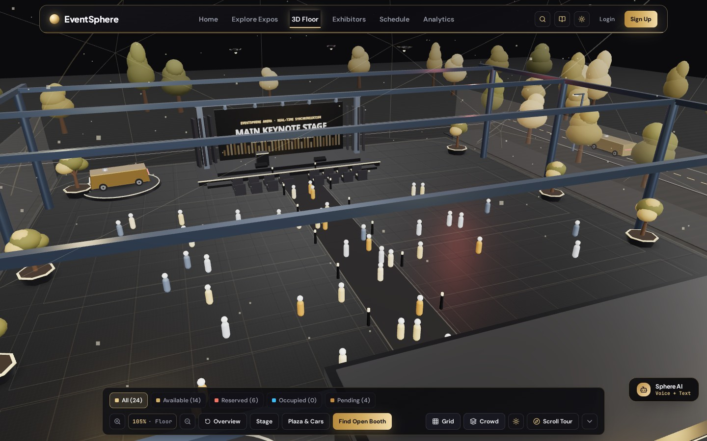
*Figure 5.1 — Full-screen interactive 3D Expo Hall (`3D Floor` mode) with OrbitControls, camera presets, status filter pills, and layer toggles.*

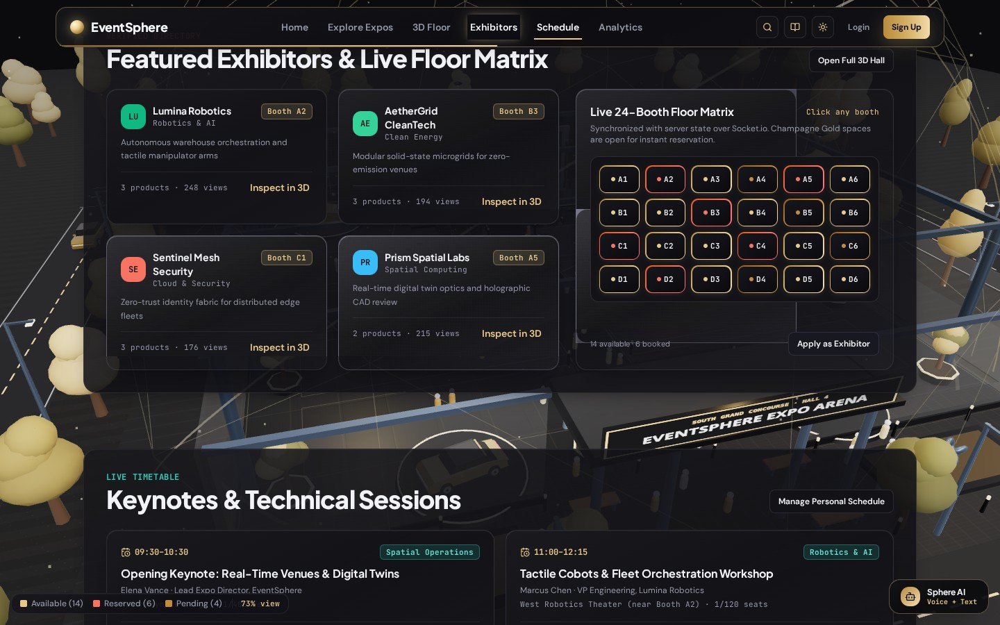
*Figure 5.2 — Verified Exhibitors Directory paired with the real-time 24-Booth interactive status matrix.*

---

## 6. Booth Inspector Drawer Tutorial

Clicking any booth on the 3D Floor, the 24-Booth Matrix, Search Results, or Analytics opens the right-hand **Booth Inspector Drawer**:

- **Header**: Displays booth status badge, hall zone (`North Innovation Wing`, `Central Atrium`, `West Robotics Row`, `South Enterprise Hall`), dimensions (`3x3m Standard`, `6x3m Corner`, `6x6m Island`), pricing (`$2,800` / `$4,200` / `$6,800`), and live visit counter.
- **Fly Camera Here**: Moves the 3D camera directly in front of the selected booth.
- **Bookmark**: Saves the booth to your **Bookmarks & Notes** view (and counts toward your Cloud Sync backup).
- **Share 3D Card**: Captures a live PNG snapshot from the 3D WebGL canvas and generates a shareable deep link (`?booth=booth-A2`) so teammates open the exact booth in 3D.
- **Reserve / Release Booth**:
  - Approved Exhibitors (or Organizers) can click **Reserve Booth** on any `available` booth. Reservations are atomic—two users cannot double-book the same booth.
  - The booth owner or Organizer can click **Release Booth** to return it to `available`.
- **Personal Field Notes**: Save private notes per booth (stored locally and backed up via Cloud Sync Vault).
- **Live Booth Chat**: Send real-time Socket.io messages directly to the booth's exhibitor channel (or Organizer Desk for unreserved booths).

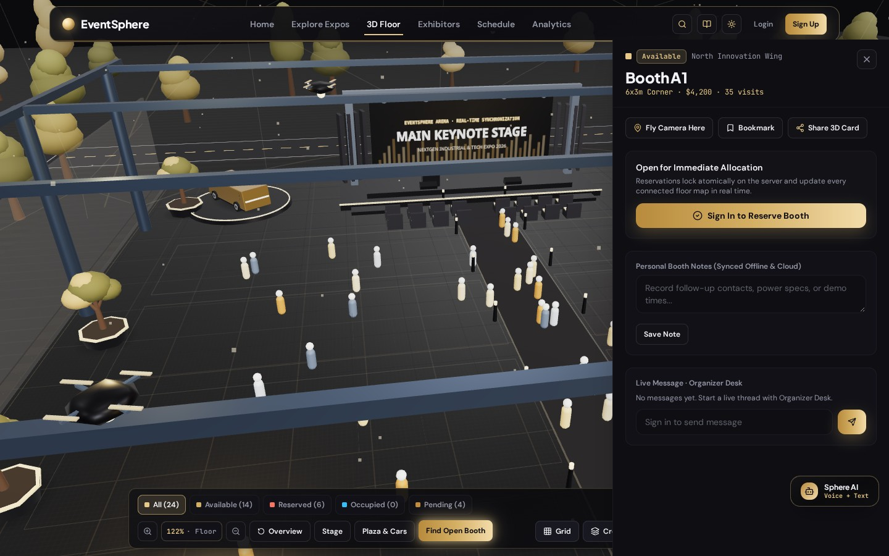
*Figure 6.1 — Slide-over Booth Inspector Drawer showing booth specifications, 3D camera focus, Share 3D Card, notes, and live chat.*

---

## 7. Attendee Guide & Tutorial

Sign in as an **Attendee** and open **Attendee Portal** (`Attendee Hub`) to access 11 dedicated sections:

1. **Overview**: View registered expos, active digital passes, bookmarked sessions, saved booths, and quick shortcuts.
2. **Explore Events**: Filter live and upcoming expos by industry sector and click **Register & Issue Pass** to claim a spot.
3. **My Registrations**: Review active expo registrations or cancel a registration if your plans change.
4. **Digital Tickets**: View your unique ticket code (e.g., `ES-2026-8412`) alongside a scannable **QR Entry Matrix** and a **Print Pass** button.
5. **Exhibitors**: Browse verified exhibitors, inspect product catalogs, increment view counters, and jump directly to their booth in 3D.
6. **Floor Plans**: Inspect the 24-booth interactive matrix or launch the full 3D Floor Explorer.
7. **Schedule**: Browse keynotes and workshops, **Register** for a seat, or **Bookmark** sessions to receive automatic 15-minute reminder notifications.
8. **Bookmarks & Notes**: Review all saved booths, personal field notes, and bookmarked sessions in one place.
9. **Notifications**: View real-time booth, schedule, and reminder alerts; mark all as read.
10. **Feedback & Support**: Submit suggestions, bug reports, or venue questions directly to the Organizer queue.
11. **Profile Settings**: Update your profile details and manage GDPR privacy consent, data export, or account deletion.

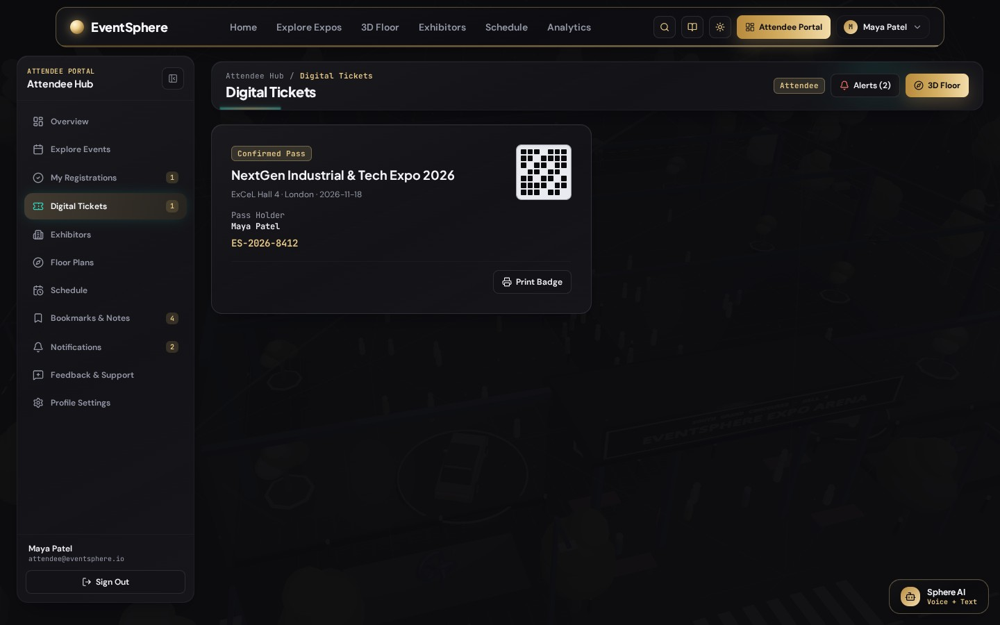
*Figure 7.1 — Attendee Hub Digital Tickets section displaying scannable 7x7 QR entry matrix (`ES-2026-8412`) and printable pass controls.*

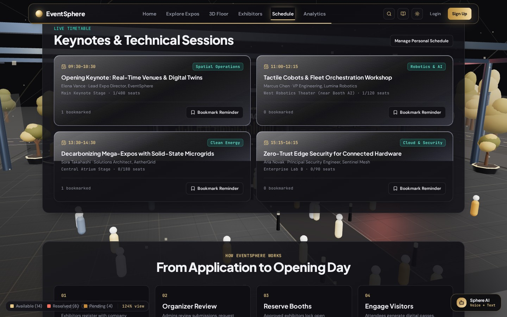
*Figure 7.2 — Keynotes & Technical Sessions live schedule with seat counts and automatic 15-minute reminder bookmarks.*

---

## 8. Exhibitor Guide & Tutorial

Sign in as an **Exhibitor** and open **Exhibitor Portal** to manage your presence:

1. **Company Profile**: Edit your company name, industry category, tagline, full description, contact email, encrypted phone, website, and **Brand Accent Color** (reflected across cards and booth branding).
2. **Applications**:
   - Select an expo, summarize your showcase products/demo power requirements, list compliance documents (e.g., `ISO-10218-Safety-Cert.pdf, Booth-Power-Spec.pdf`), and submit.
   - Track review status: `Pending`, `Approved`, `Info Requested` (with reviewer note), or `Rejected` (with reason).
3. **Booth Selection & My Booth**:
   - Once approved, browse open booths across all 4 zones, compare sizes (`3x3m Standard` `$2,800`, `6x3m Corner` `$4,200`, `6x6m Island` `$6,800`), and click **Reserve Booth** to lock it atomically.
   - Use **My Booth** to inspect your reserved booths on the 3D floor or release a booth back to the floor.
4. **Products & Services**: Add or remove showcased products displayed to attendees in the directory and Booth Inspector.
5. **Staff Management**: Maintain your on-site booth staff roster.
6. **Messages**: Chat in real time with the **Organizer Desk** (for power drops, logistics, or approvals) or monitor visitor inquiries on your exhibitor channel.

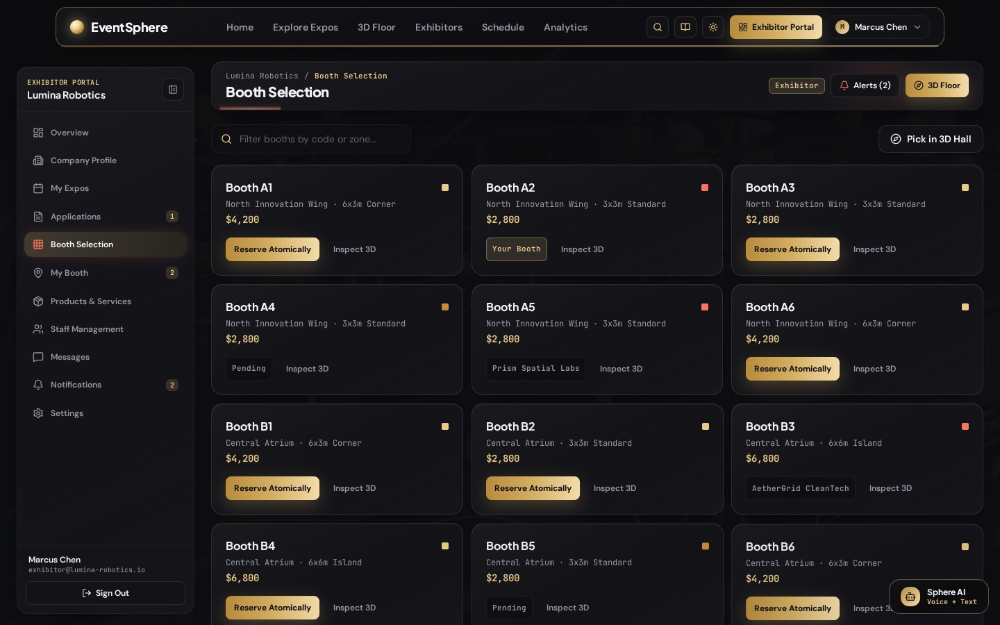
*Figure 8.1 — Exhibitor Portal Booth Selection grid across North Innovation Wing, Central Atrium, West Robotics Row, and South Enterprise Hall.*

---

## 9. Organizer (Admin) Guide & Tutorial

Sign in as an **Organizer** and open **Organizer Command Center** (`Admin`):

1. **Overview**: Monitor live concurrent floor users, pending exhibitor applications, open feedback tickets, booked booths, and recent audit activity logs.
2. **Expo Management**: Create new expos (`title`, `date`, `endDate`, `location`, `theme`, `category`, `status`, `capacity`, `description`), edit existing expos (automatically broadcasts a system notification), or delete expos.
3. **Exhibitor Applications**: Filter by status (`All`, `Pending`, `Info Requested`, `Approved`, `Rejected`) and take action:
   - **Approve**: Unlocks booth reservation for the exhibitor and triggers email/in-app notification.
   - **Request Info**: Sends a custom reviewer note requesting updated compliance docs.
   - **Reject**: Records a clear rejection reason and notifies the applicant.
4. **Booth Management & Floor Plan**:
   - Create new booths (`number`, `zone`, `size`, `priceUsd`).
   - Edit booth size, price, status (`available`, `reserved`, `occupied`, `pending`), or assign/unassign an exhibitor directly.
   - Delete unoccupied booths, or click any booth to inspect it in 3D.
5. **Schedule Management & Speakers**:
   - Add, reschedule, or delete keynote and technical sessions. Every schedule edit broadcasts a real-time `schedule:updated` WebSocket event and notification to all connected users.
   - Manage the Speaker directory (`name`, `role`, `company`, `topic`, `bio`).
6. **Attendees**: Search the Attendee Directory (with decrypted contact details and registration counts).
7. **Analytics & Reports**: Open the interactive **Expo Analytics Dashboard** with custom date-range presets (`7D`, `14D`, `30D`), hoverable SVG traffic trends, booth revenue & occupancy KPIs, session popularity bars, **Export CSV**, **Export JSON**, and **Print Report**.
8. **Messages & Feedback Queue**: Respond to exhibitor/attendee messages and mark feedback tickets as `Resolved` or reopen them.
9. **Settings**: Inspect live server telemetry (`Uptime`, `Total Requests`, `Avg Latency`, `p95 Latency`, `Error Count`, `MongoDB / JSON Storage Mode`, `SMTP Status`, `AES-256-GCM Encryption`), trigger manual JSON/MongoDB snapshot backups, and manage GDPR compliance.

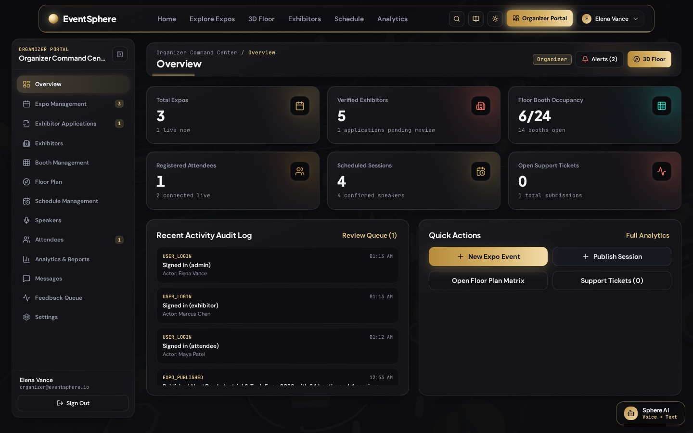
*Figure 9.1 — Organizer Command Center overview with live floor occupancy KPIs, quick actions, and recent audit trail activity logs.*

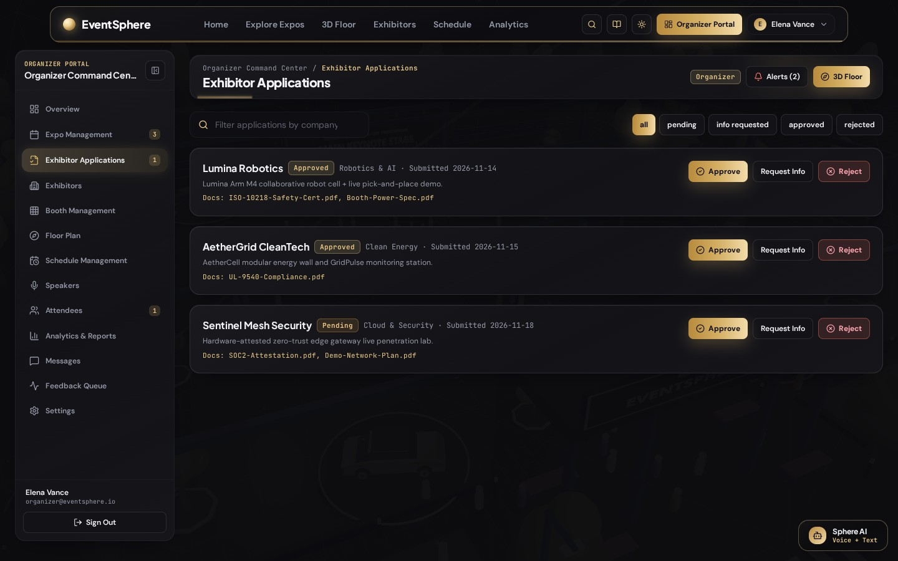
*Figure 9.2 — Organizer Exhibitor Applications queue supporting one-click Approve, Request Info, and Reject workflows.*

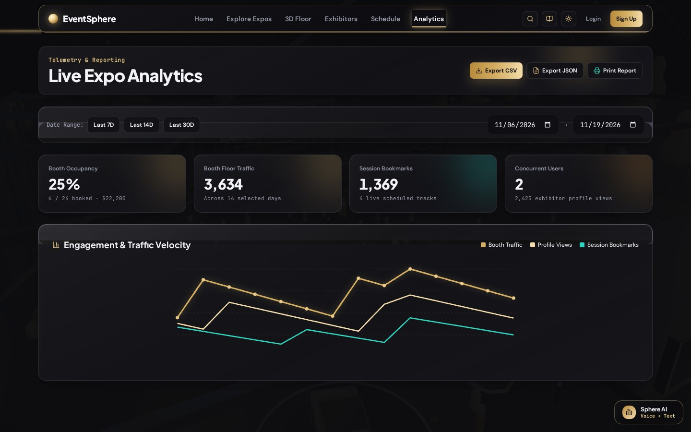
*Figure 9.3 — Live Expo Analytics Dashboard with date-range filters, multi-series velocity SVG charts, and CSV/JSON/Print export.*

---

## 10. EventSphere AI Concierge (Text & Voice)

Click the **Sphere AI (Voice + Text)** floating button in the bottom-right corner of any screen:

- **Three Context-Aware Personas**:
  - **Concierge**: Helps attendees find open booths, sessions, and exhibitor locations.
  - **Exhibitor**: Compares booth sizes/pricing (`$2,800` / `$4,200` / `$6,800`), recommends corner/island booths, and explains approvals.
  - **Operations**: Summarizes zone occupancy, pending reviews, and real-time sync architecture.
- **Fast Mode (`Zap`)**: Toggles between `gemini-4-hydrogen` (full reasoning) and `gemini-3.1-flash-lite` (ultra-fast replies).
- **Voice Mode & Audio Synthesis**:
  - Toggle **Voice Mode** on/off and choose from 5 voices: `Kore`, `Puck`, `Charon`, `Fenrir`, or `Zephyr`.
  - Hold/click the **Microphone** button to record a spoken question—EventSphere transcribes your speech and automatically reads the reply aloud.
- **Clickable Booth Links**: Whenever the assistant mentions a booth code (e.g., `Booth A2`), clickable badge pills appear below the message to fly the 3D camera straight to that booth.

> **Note:** The AI Concierge requires `GEMINI_API_KEY` to be configured on the server environment.

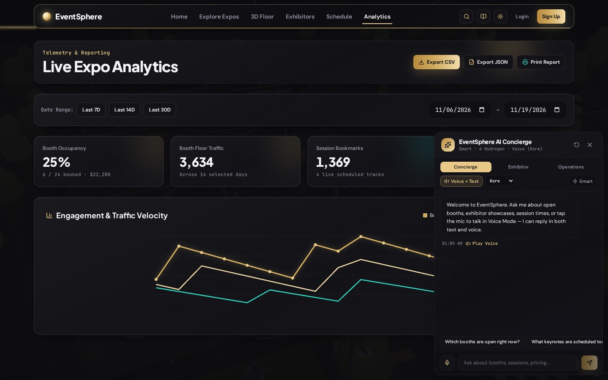
*Figure 10.1 — EventSphere AI Concierge drawer showing role personas (`Concierge`, `Exhibitor`, `Operations`), voice selection, and quick prompts.*

---

## 11. Venue Weather Telemetry

On the home Scroll Tour hero, the **Venue Weather Widget** displays live conditions for the active expo's city (e.g., `ExCeL Hall 4 · London`, `Moscone West · San Francisco`, `Messe Berlin · Hall 2`) powered by **Open-Meteo**:

- Shows current temperature, feels-like temperature, high/low, humidity, wind speed, and precipitation.
- Click **°C / °F** to switch temperature units instantly.
- Click the **Expo Selector** pills or **Refresh** icon to fetch live forecasts for another venue.

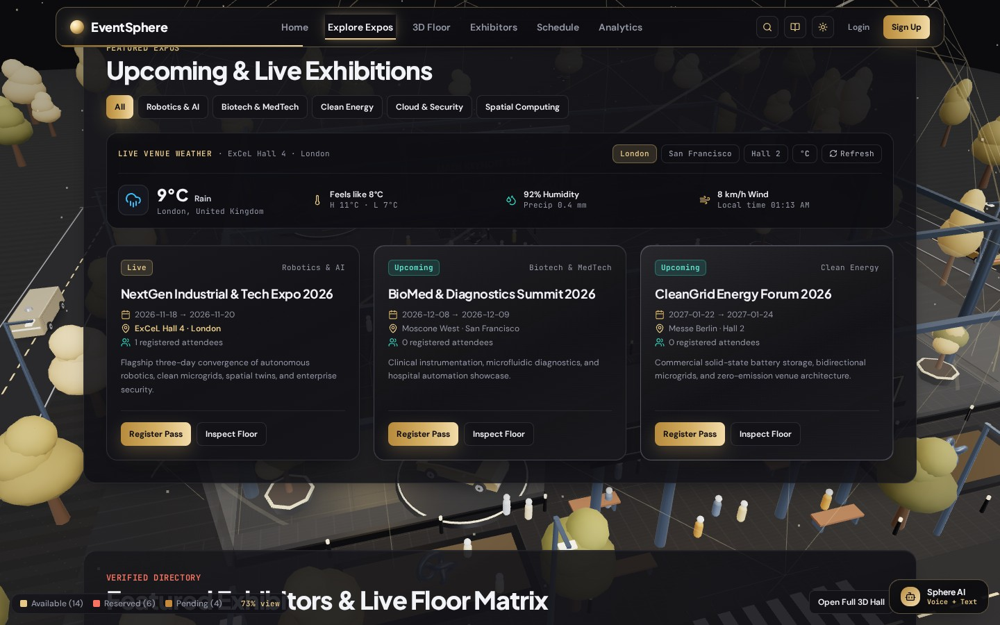
*Figure 11.1 — Upcoming & Live Exhibitions section with live Open-Meteo Venue Weather Telemetry (`London`, `San Francisco`, `Hall 2`).*

---

## 12. Offline PWA & Cross-Device Cloud Sync Vault

### Installing EventSphere as an App (PWA)
- EventSphere caches core assets, floor state, schedules, and personal bookmarks via a Service Worker (`vite-plugin-pwa`).
- Click **Install App** (or use your browser's **Install EventSphere** prompt) to run EventSphere offline inside low-signal convention halls. An offline banner automatically notifies you if connectivity drops.

### Cross-Device Cloud Sync Vault
1. Open the **Cloud Sync Vault** from the User Menu (or Cloud icon).
2. Copy your generated **Sync Key** (e.g., `ES-AB12-CD34`) or click **New Key**.
3. Click **Push to Cloud** to save your bookmarked booths, personal field notes, and hall preferences to the server (with SHA-256 checksum verification).
4. On another device, enter the same **Sync Key** and click **Pull from Cloud** to restore your workspace.
5. You can also use **Export JSON** and **Import JSON** for portable offline file backups.

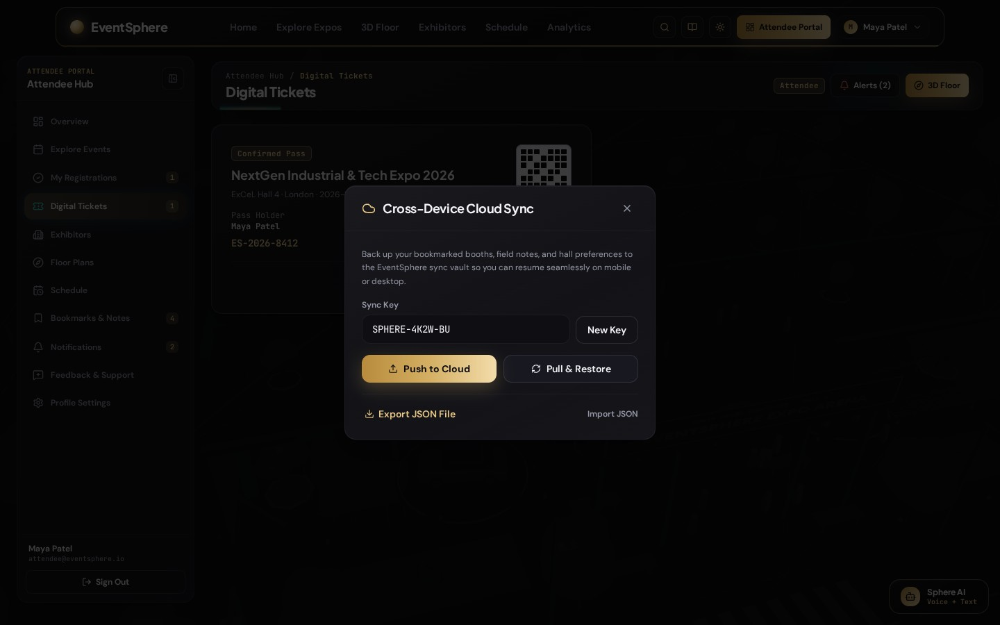
*Figure 12.1 — Cross-Device Cloud Sync Vault (`PUT /api/sync/:syncKey`) with SHA-256 integrity checks and portable JSON export/import.*

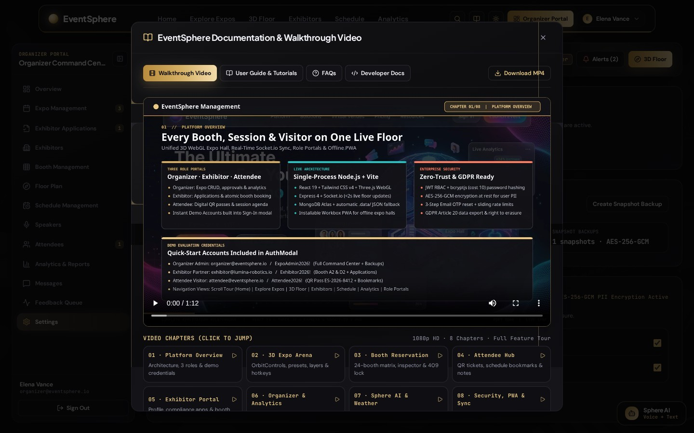
*Figure 12.2 — Built-in Documentation & 1080p HD Walkthrough Video Center accessible from the TopNav and Footer.*

---

## 13. GDPR Privacy & Compliance Controls

Inside any Portal's **Profile Settings / Settings** tab, the **Privacy & Compliance Card** provides full GDPR controls:
- **Granular Consent Toggles**: Enable or disable **Analytics Telemetry** and **Event Marketing Emails** independently (`PUT /api/auth/privacy/consent`).
- **Article 20 Data Portability Export**: Click **Export My Data (JSON)** to download a complete machine-readable bundle of your account, registrations, applications, messages, and feedback.
- **Right to Erasure (Account Deletion)**: Permanently erase your personal account and anonymize historical records (`DELETE /api/auth/account`).

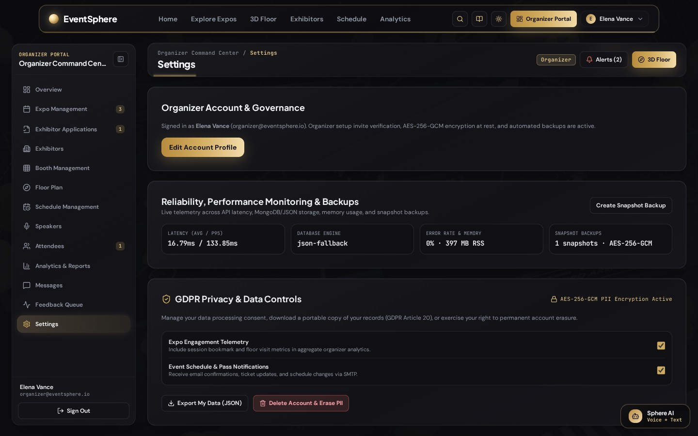
*Figure 13.1 — Organizer Settings showing live latency monitoring, backup status, AES-256-GCM encryption, and GDPR Consent / Export / Erasure controls.*

---

## 14. Frequently Asked Questions (FAQs)

**Q1: Can two exhibitors reserve the same booth at the same time?**  
No. Booth reservations are validated atomically on the server. If another user reserves a booth first, the server returns a `409 Conflict` error and updates all connected floors over Socket.io within 2 seconds.

**Q2: Why does an exhibitor see "Your exhibitor application must be approved before reserving a booth"?**  
If an exhibitor has submitted an application that is still `pending`, `info_requested`, or `rejected`, the server enforces approval before allowing a booth lock. Organizers can approve applications in **Organizer Portal → Exhibitor Applications**.

**Q3: How do I register as an Organizer (Admin)?**  
Organizer sign-up requires the server-configured `ORGANIZER_SETUP_CODE` invite code to prevent privilege escalation. Alternatively, use the **Demo Organizer** button for immediate evaluation.

**Q4: Why is the 3D Floor running slowly on an older laptop?**  
EventSphere automatically detects software WebGL renderers (`SwiftShader` / `llvmpipe`) and disables heavy bloom post-processing to keep frame rates smooth. You can also toggle off **Crowd** and **Grid** in the bottom 3D HUD to boost performance.

**Q5: Where are my booth bookmarks and personal field notes stored?**  
They are saved immediately in browser `localStorage` for offline access and can be synced across devices using your **Cloud Sync Key** (`PUT /api/sync/:syncKey`).

**Q6: How do I share a specific booth with a colleague?**  
Click the booth on the 3D Floor, then click **Share 3D Card** in the Booth Inspector Drawer. You can copy a direct deep link (`?booth=booth-A2`) or download a live 3D PNG snapshot of the booth.

**Q7: What happens if I lose Wi-Fi inside the exhibition hall?**  
EventSphere's Service Worker and local snapshot cache keep your floor map, exhibitor directory, schedules, digital QR tickets, and saved notes available offline. Live mutations (like reserving a booth or sending chat) automatically resume once connectivity returns.

**Q8: Why didn't I receive the 6-digit password reset email?**  
Email delivery requires SMTP credentials (`SMTP_HOST`/`SMTP_USER`/`SMTP_PASSWORD`, `GMAIL_USER`/`GMAIL_APP_PASSWORD`, or `BREVO_API_KEY`) configured on the server. When SMTP is inactive, the server safely skips outbound mail while keeping the API contract intact.

**Q9: How is my personal phone number protected?**  
All user and exhibitor phone numbers are encrypted at rest using **AES-256-GCM** (`enc:v1:...`) derived via `scrypt` from `DATA_ENCRYPTION_KEY`.

**Q10: How do I export expo analytics for stakeholders?**  
Open **Analytics** from the top navigation bar, select your desired date range (`7D`, `14D`, `30D`, or custom dates), and click **Export CSV**, **Export JSON**, or **Print Report**.
